# WFRP4e – Grimoires (`wfrp4e-grimoires`)

**English** | [Polski](README.pl.md)

Tomes and scrolls for **WFRP4e 10.x** and **Warhammer: The Old World**: their own inventory sections and an open-book window with a table of contents, full details of each entry, casting from the book and memorising spells with GM approval. A tome can hold more than spells: other modules add their own kinds of entries, such as the recipes of *Old World Alchemy*.

## 📖 How it works

* A tome is an ordinary system item (a *Books and Documents* trapping) marked by the module. It keeps its weight, price, availability, containers and trading, and works with Item Piles. Without the module it is just a book.
* **Tomes** get their own inventory section with a **Carried** toggle. The book icon in the row (or the item picture) opens the tome, and **+** creates a new one.
* Create a new one in the **Create Item** window by choosing the **Tome** type.
* Any book can become a tome: **Make into tome** in the item sheet header.

## 🪄 The tome window

* **Left page**: spells grouped by Lore, with CN, a search box and markers: *memorised* ✔, *on your sheet, not memorised* 📖 and *read only* 👁.
* **Right page**: the selected spell's CN, range, target, duration and full description. The page turns as you pick a spell.
* In the *Illuminated* look (default) the tome opens on a title page and a table of contents with page numbers and blank pages for free entries. Every entry has its own spread; turn the pages with the page corners, the arrow keys (Home returns to the contents) or the coloured ribbons below the pages. A long description continues on the next sheet.
* **Header**: requirement badges for the character, Read/Write, the book's language and Carried.
* **Actions**: **Cast from the grimoire**, **Channel** (4e), **Memorise**, **To chat**, **Spell sheet**.
* Characters who can't read the book see illegible runes instead of spell names. The GM always sees the text.
* **Edit mode** (✒ button, owner and GM only): drag entries onto the book, reorder or remove them, set the language (Magick, Reikspiel, Eltharin… or your own), pick the cover colour and decide what this book requires of its reader: literacy, its language, being carried and, for spells, knowing the Lore.

## 🎨 Illuminated look

By default (client setting **Tome look**) a tome looks like an illuminated spellbook: a leather cover in the book's colour with brass fittings, parchment pages, gilt titles in the WFRP4e fonts and silk ribbons hanging below the pages.

* **Pages**: the tome opens on a title page and a table of contents. Each entry has its own spread; a long description continues on further sheets. Turn the pages with the page corners, the arrow keys (Home returns to the contents) or the ribbons.
* **Schools of magic**: each school has its own ink colour, sigil and corner marginalia, and marks its pages in its own way, e.g. scorched edges for Fire, a mourning border for Death, a star chart for the Heavens, black rubrics for Daemonology.
* **Rituals** fill the whole book and get a ritual circle and numbered rubrics.
* **Locked pages**: runes and a lock with wax seals for decoding progress, chains and a skull seal for forbidden pages. The colours don't give away the school of a page the character can't read.
* **Scriptorium**: edit mode is a writing desk, and blank pages light up while you drag a spell over the tome.
* **Scroll and chat**: the scroll gets a wax seal of its school; a spell sent to chat looks like a page torn from the tome.
* Everything works from the keyboard and every icon has a label for screen readers.

| | |
|---|---|
| 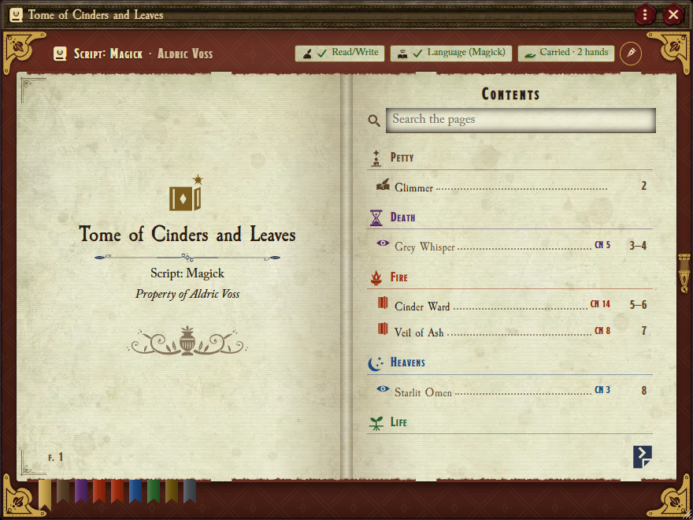 | 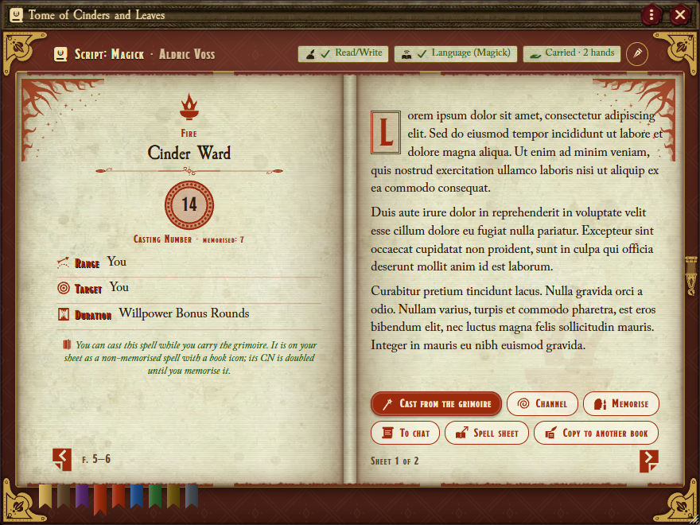 |
| 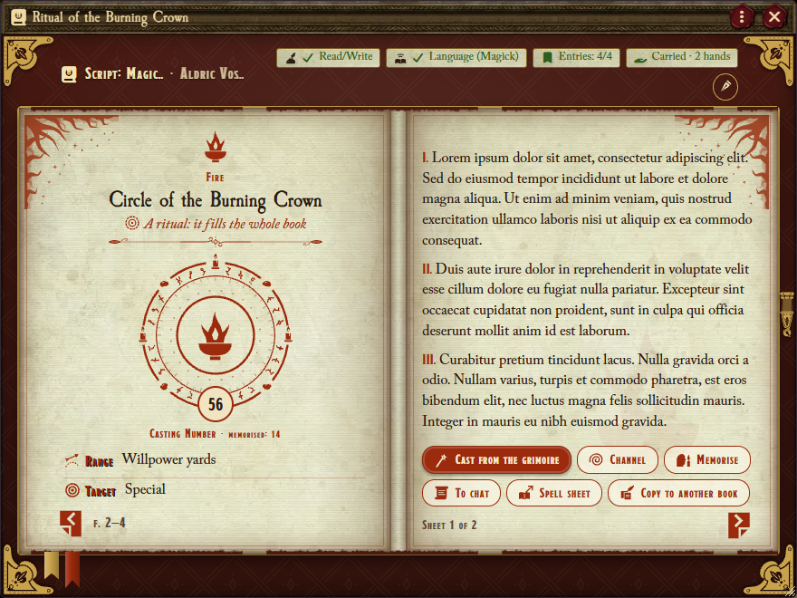 | 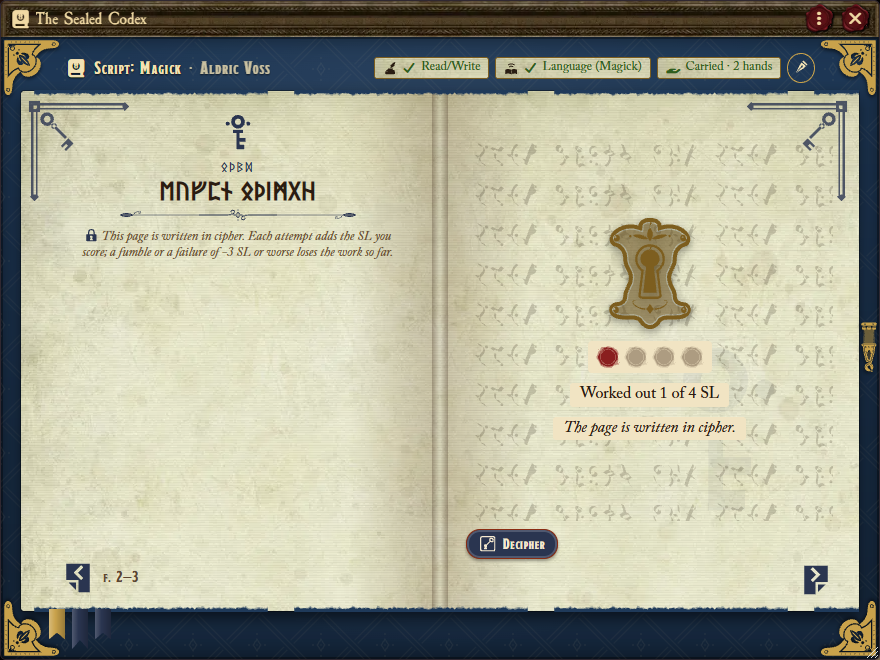 |

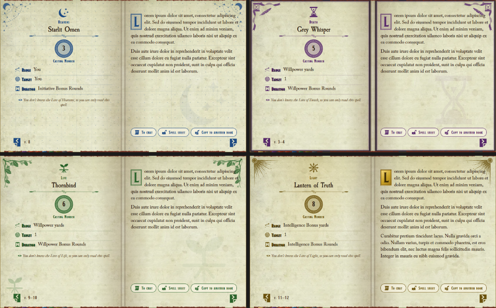

| | |
|---|---|
| 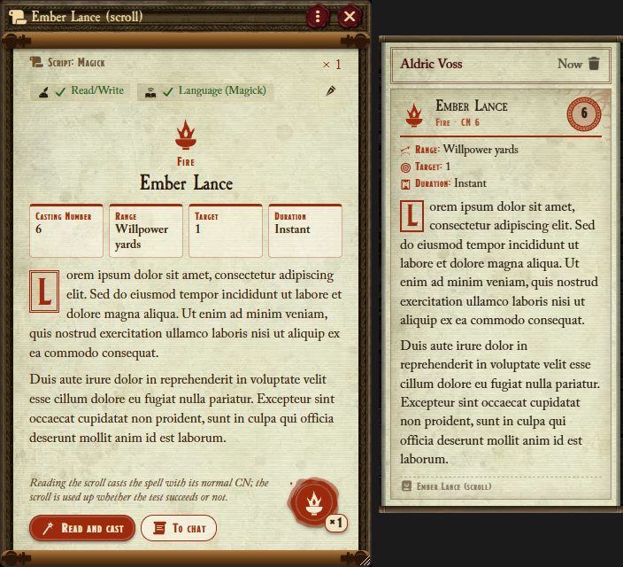 | 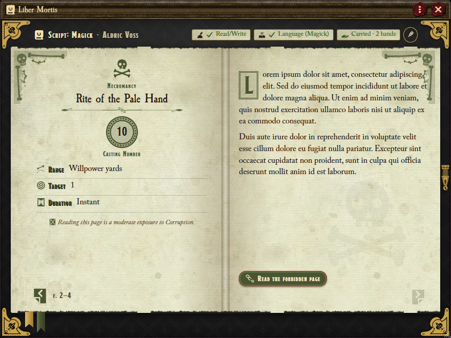 |

## ✨ Spells from the grimoire on the sheet

This follows the WFRP 4e rules as the system implements them: a spell on the sheet that is **not memorised** (empty **M**) is cast from a grimoire, and a miscast rolls on the system's *Grimoire Miscast* table.

While a grimoire is carried, every spell the character can cast from it appears in the **Magic** tab as a non-memorised spell with a book icon. Cast it from the sheet, the Action HUD or the grimoire window, and chat cards work as usual. These copies disappear when the grimoire leaves the character, is no longer carried or loses the spell. They come back if the character forgets a memorised spell that the grimoire still holds.

| | |
|---|---|
| 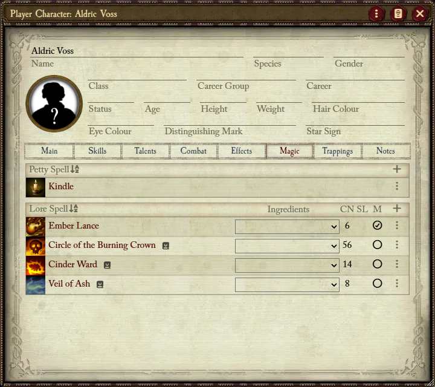 | 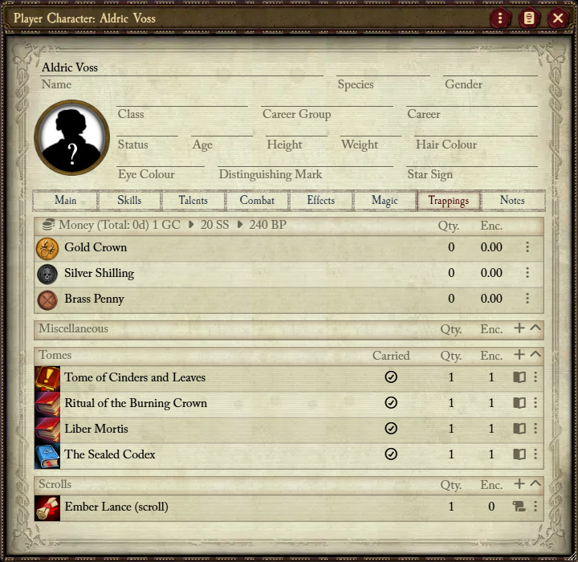 |

## 🎓 Memorising

**Memorise** asks the GM. After the GM allows it, the system's own *Memorize Spell* dialog sets the XP cost by the rules (Ok / Free). The spell becomes the character's own: **M** is ticked, it no longer depends on the grimoire, and the XP is logged. Ticking **M** on a grimoire copy straight on the sheet does the same.

## 🔏 What a book can demand

A new tome holds **4 entries**, as an ordinary spellbook holds about four spells. A **ritual takes the whole book**: it goes only into an empty tome, and nothing else fits after it. The GM can change the number of entries per book in edit mode or leave the field empty for no limit. Tomes made before this rule, scrolls and alchemy recipe books have no entry limit.

Everything below is off by default. The GM sets it per book in edit mode.

* **Pages**: a limit on how much fits. A spell takes 1 page, plus 1 for every 5 CN.
* **Cipher**: each page must be worked out with a test of the skill you choose (the book's language by default). Each success adds its SL, and a page needs the set SL per page. A fumble or a failure of -3 SL or worse loses the work on that page. Progress belongs to the character.
* **Forbidden**: reading a page for the first time is a Corruption exposure of the chosen strength, using the system's own test. Players don't see this in advance: to them the page is simply unread, with a **Read the page** button, and they learn about the Corruption only from the test. The GM sees the warning everywhere.
* **Hands**: a carried tome is held in both hands by default (the GM can set one hand or none). It counts towards the character's equip points like a weapon, so with the system setting that limits equipped weapons a character can't hold the book and draw a weapon beyond their free hands, and the header shows how many hands it takes.

**Copy to another book** writes an entry into another of the character's books with a Challenging test. A failure leaves a flawed copy (a spell has CN +2), and a failure of -2 SL or worse ruins it.

## 📜 Scrolls

* A scroll is a one-entry tome that is used up: a *Books and Documents* trapping with a language, and its quantity is the number of scrolls. Scrolls get their own **Scrolls** inventory section; any document can become one with **Make into scroll**.
* The scroll window shows the entry, the requirement badges and how many scrolls are left.
* **Read and cast** runs the system's normal casting test with the spell's base CN, even if the character doesn't know the spell, so chat cards (damage, overcasting) work as usual. One scroll is used up afterwards (optionally only after a successful test). The last one crumbles to dust.
* Anyone who can read the scroll (Read/Write and its language, if required) can cast from it; knowing the Lore isn't needed.

## ⚙️ Settings (world)

* Failed scroll test uses up the scroll
* Name scrolls after their contents

Each player also chooses the **Tome look** (client setting): *Illuminated* (default) shows a leather-bound spellbook with brass fittings, styled by the school of magic, or *Classic* keeps the plain look.

What a book requires of its reader is set on each book, in edit mode.

Talents and skills are recognised in **English and Polish** (e.g. *Arcane Magic (Life)* / *Magia Tajemna (Życia)*, *Language (Magick)* / *Język (Magiczny)*), whatever language the Foundry interface uses. A character also counts as knowing a Lore if they already know a spell of it.

## 🏰 Warhammer: The Old World

The module also works in **Warhammer: The Old World** (system `whtow`). The tome window, table of contents, illuminated pages, ciphers, copying between books and scrolls are the same, but the rules follow that system:

* Following The Old World rules (*Formalise Spell*, *Memorise Spell*), a wizard casts spells from their grimoire, and a memorised spell no longer needs it. An equipped tome (**Carried**) therefore puts copies of its spells from Lores the character knows onto the sheet (with a book icon). They are cast like any spell on the sheet: a Lore test builds up power, and once it reaches the Casting Value you pick the spell in chat. The value is not doubled. Unequipping the tome takes the copies off the sheet. **Memorise** (with GM approval) turns a copy into the character's own spell. Spells cost no XP in that system.
* The medallion shows the **Casting Value (CV)**. Range, target and duration show the system's value and its custom text. Lores get the module's school looks: Battle as Fire, Elementalism as the Heavens, Illusion as Shadow, Necromancy and Daemonology as their own, and other spells as plain magic.
* Tomes and scrolls get their own sections under Trappings. A tome is a trapping you can equip; equipped means **Carried**.
* The system has no Read/Write talent, Language skill, equip points or Corruption test for reading, so those requirements and settings are off. A book still needs to be carried, and the **Lore** requirement is met by a character who already knows a spell of that Lore (the GM can switch it off for an apprentice's first spell).
* Ciphers use a test of the skill named on the book (Recall by default) and count successes. A failed copy is flawed (CV +2), never ruined.
* Scrolls keep the text of a spell, but the system has no casting from scrolls.

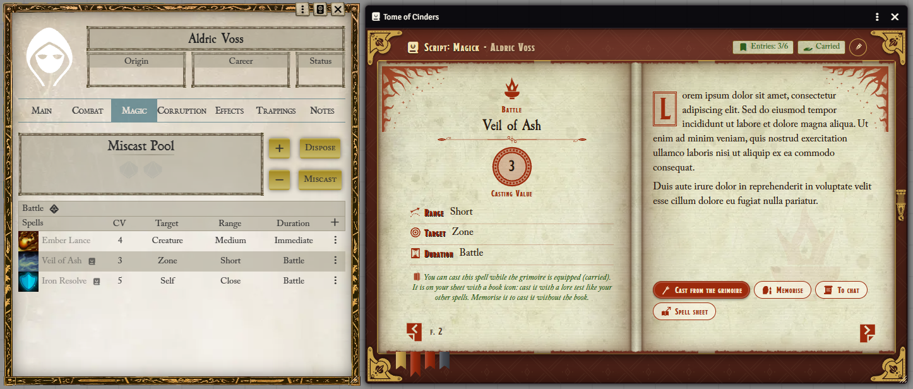

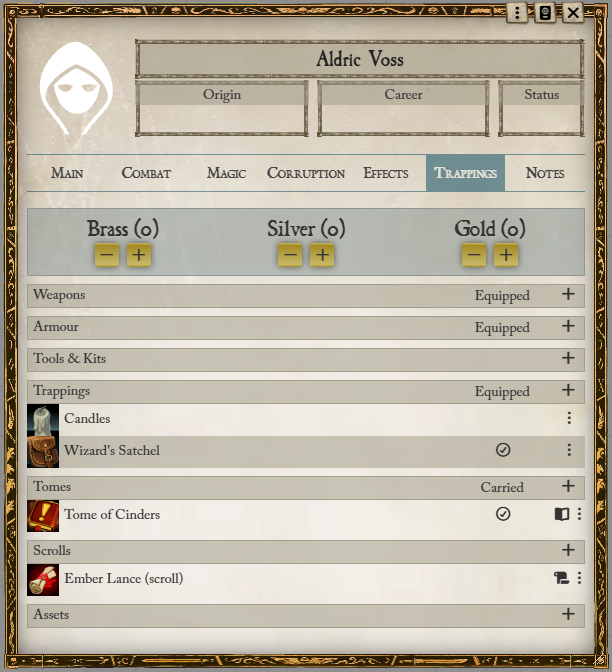

## 📦 Requirements

* Foundry VTT **v14**
* WFRP4e system **10.0+** or Warhammer: The Old World system **1.3+**

## 🔌 API

```javascript
const api = game.modules.get("wfrp4e-grimoires").api;
api.create(actor);   // new tome on a character
api.make(item);      // turn a book into a tome
api.open(item);      // open the tome window
api.read(item);      // { form, language, cover, requirements, entries: [{ id, type, sourceUuid, data }] }
api.registerEntryType(type); // add a new kind of entry
```

Modules can also register a **book kind** (`registerBookKind` in `scripts/public.mjs`, contract in `scripts/book-kinds.mjs`): the same tome window with its own inventory section, Create Item entry, defaults, accepted entry types and look. A kind can work straight from the inventory without being held. Old World Alchemy uses this for alchemical books.

An entry type decides how an entry looks and what it can do; the window, table of contents, reading requirements and editing are shared. The contract is described in `scripts/entry-types.mjs`. Modules of this series import `scripts/public.mjs` directly. Entries of a disabled module stay in the book and work again when it comes back.

## 🌐 Languages

English and Polish are built in. To add another language:

```bash
npm run lang:add -- de "Deutsch"
```

This creates `lang/de.json` (a copy of the English texts) and registers it in `module.json`. Translate the texts; any key you leave out falls back to English, and `npm run check` lists the untranslated keys. Translations are welcome as pull requests.

For a new language also fill in the `Aliases` section: the names of the Read/Write, Petty Magic and Arcane Magic talents, the Language skill, the Lores and the book languages as they appear in that language's compendia (comma-separated). The module then recognises characters' talents and skills in that language.

A separate translation module can also add a language without touching this one: it declares a `languages` entry with `"lang": "de"` that points to its own file with the same keys.

## 🙏 Credits

Inspired by the grimoires in *Forien's Armoury* by Forien. Written from scratch for Foundry v14 and WFRP4e 10.x.

## 📄 License

MIT – see [LICENSE](LICENSE). The Polish-language fonts Grenze Gotisch (Omnibus-Type) and Almendra (Ana Sanfelippo) are under the SIL Open Font License; their licences are in `assets/fonts`.

Unofficial fan content, not affiliated with or endorsed by Games Workshop or Cubicle 7. Warhammer and all related names are trademarks of Games Workshop Limited. The module ships no rulebook text or artwork; it works with the content you already own.
