# WFRP4e – Księgi zaklęć (`wfrp4e-grimoires`)

[English](README.md) | **Polski**

Księgi i zwoje dla **WFRP4e 10.x** i **Warhammer: The Old World**: osobne działy w ekwipunku i okno otwartej księgi ze spisem treści, pełnymi szczegółami wpisu, rzucaniem z księgi i zapamiętywaniem zaklęć za zgodą MG. Księga może zawierać nie tylko zaklęcia: inne moduły dokładają własne rodzaje wpisów, na przykład receptury z *Alchemii Starego Świata*.

## 📖 Jak to działa

* Księga to zwykły przedmiot systemu (*Książki i dokumenty*) oznaczony przez moduł. Ma wagę, cenę, dostępność, kontenery i handel, działa z Item Piles. Bez modułu zostaje zwykłą książką.
* **Księgi** mają własny dział w ekwipunku z przełącznikiem **Przy sobie**. Ikona książki w wierszu (albo obrazek przedmiotu) otwiera księgę, a **+** tworzy nową.
* Nową księgę tworzysz w oknie **Utwórz przedmiot**, wybierając typ **Księga Zaklęć**.
* Każdą książkę można zamienić w księgę: **Uczyń księgą** w nagłówku arkusza przedmiotu.

## 🪄 Okno księgi

* **Lewa strona**: zaklęcia pogrupowane według Tradycji, z PM, wyszukiwarką i znacznikami: *zapamiętane* ✔, *na karcie, niezapamiętane* 📖 oraz *tylko do czytania* 👁.
* **Prawa strona**: PM, zasięg, cel, czas trwania i pełny opis wybranego czaru. Strona przewraca się przy wyborze zaklęcia.
* W wyglądzie *Iluminowanym* (domyślnym) księga otwiera się na karcie tytułowej i spisie treści z numerami kart oraz czystymi kartami na wolne zapisy. Każdy zapis ma własną rozkładówkę; strony przewraca się rogami kart, strzałkami (Home wraca do spisu) albo kolorowymi wstążkami pod kartami. Długi opis przechodzi na kolejną kartę.
* **Nagłówek**: plakietki warunków dla postaci, czyli Czytanie/Pisanie, język księgi i Przy sobie.
* **Akcje**: **Rzuć z księgi**, **Splataj** (4e), **Zapamiętaj**, **Na czat**, **Karta zaklęcia**.
* Postać, która nie umie przeczytać księgi, widzi nieczytelne runy zamiast nazw zaklęć. MG zawsze widzi treść.
* **Tryb edycji** (przycisk ✒, tylko właściciel i MG): przeciąganie wpisów na księgę, kolejność, usuwanie, język (Magiczny, Reikspiel, Eltharin… albo własny), kolor oprawy oraz to, czego ta księga wymaga od czytelnika: umiejętności czytania, znajomości języka, noszenia przy sobie, a przy zaklęciach także znajomości Tradycji.

## 🎨 Wygląd iluminowany

Domyślnie (ustawienie klienta **Wygląd ksiąg**) księga wygląda jak iluminowana księga zaklęć: skórzana oprawa w kolorze księgi z mosiężnymi okuciami, pergaminowe karty, złocone tytuły czcionkami WFRP4e i jedwabne wstążki zwisające spod kart.

* **Strony**: księga otwiera się na karcie tytułowej i spisie treści. Każdy zapis ma własną rozkładówkę, a długi opis przechodzi na kolejne karty. Strony przewraca się rogami kart, strzałkami (Home wraca do spisu) albo wstążkami.
* **Szkoły magii**: każda ma własny kolor atramentu, sigil i marginalia w rogach oraz własny znak na stronie, np. przypalone brzegi dla Ognia, żałobną obwódkę dla Śmierci, mapę nieba dla Niebios, czarne rubryki dla Demonologii.
* **Rytuał** wypełnia całą księgę i dostaje krąg rytualny oraz numerowane rubryki.
* **Strony zamknięte**: runy i zamek z pieczęciami postępu odczytu, łańcuchy i pieczęć z czaszką dla stron zakazanych. Kolory nie zdradzają szkoły strony, której postać nie może odczytać.
* **Skryptorium**: tryb edycji to pulpit pisarski, a czyste karty świecą, gdy przeciągasz zaklęcie nad księgę.
* **Zwój i czat**: zwój ma woskową pieczęć swojej szkoły, a zaklęcie wysłane na czat wygląda jak strona wyrwana z księgi.
* Wszystko działa z klawiatury, a każda ikona ma opis dla czytników ekranu. Zrzuty pokazują interfejs angielski.

| | |
|---|---|
| 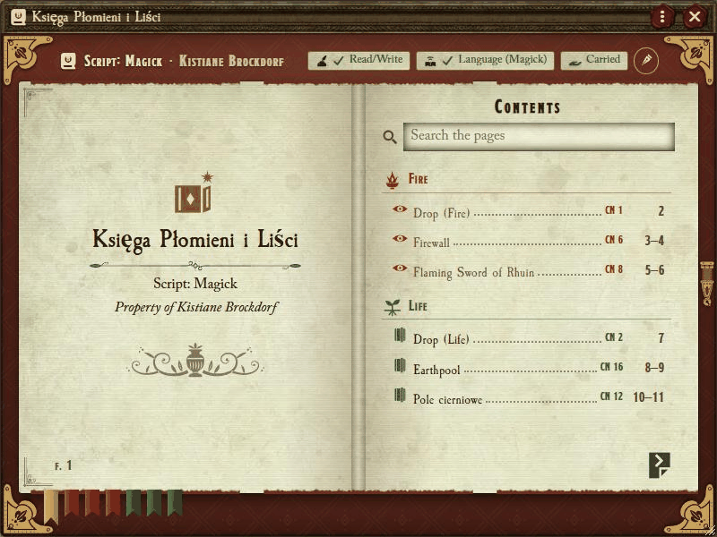 | 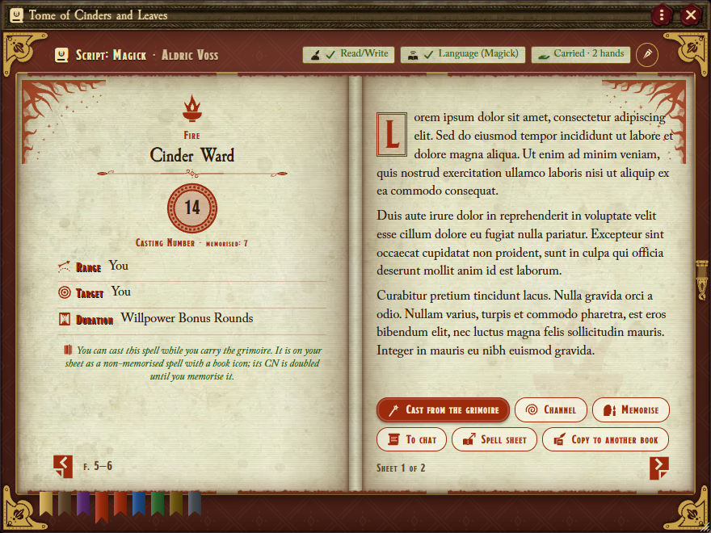 |
| 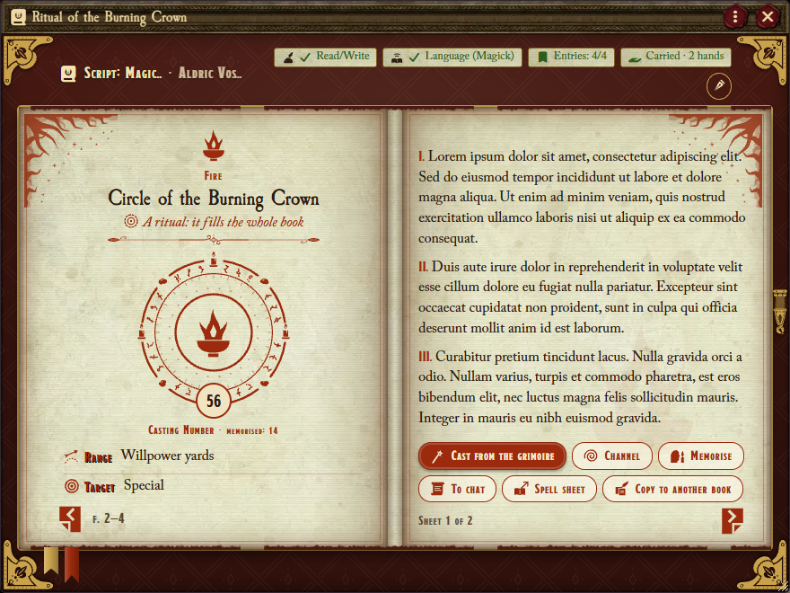 | 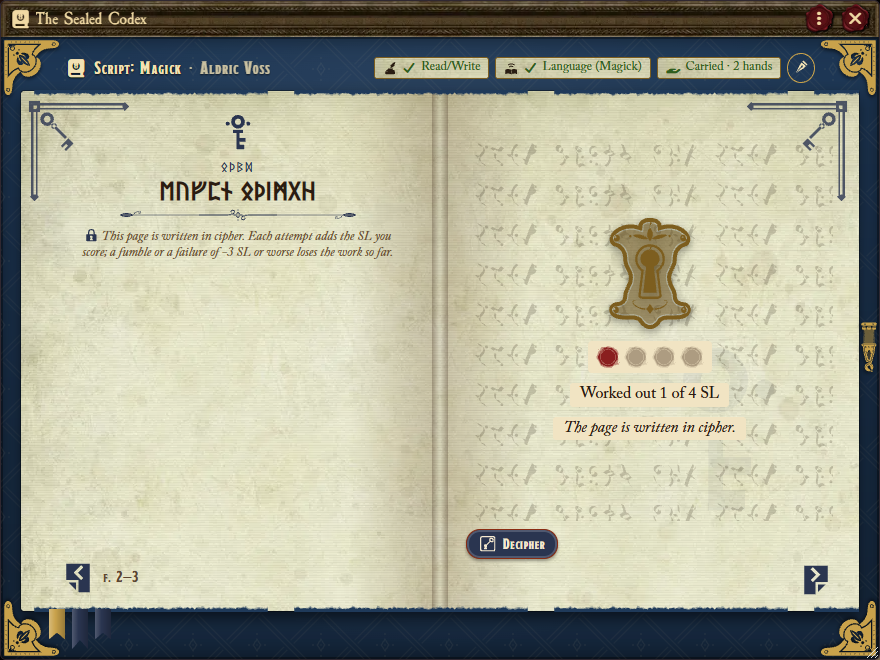 |

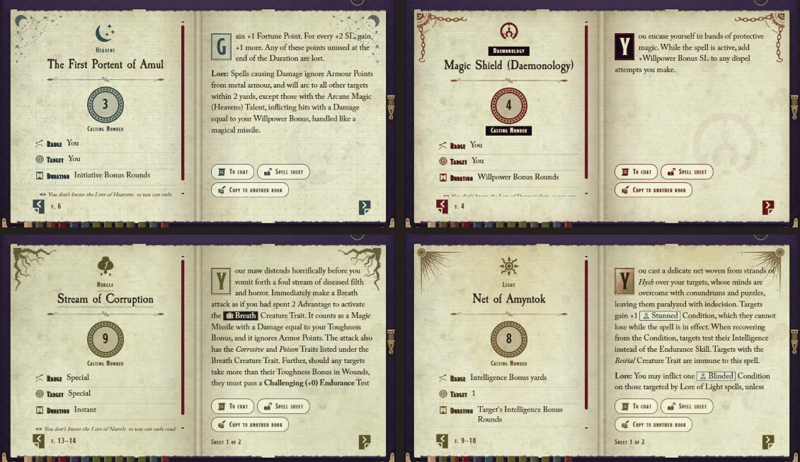

| | |
|---|---|
| 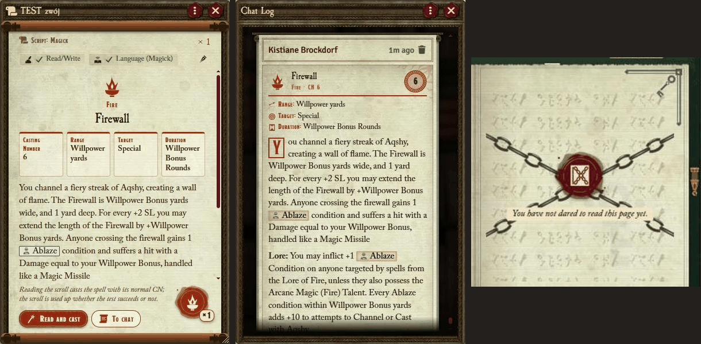 | 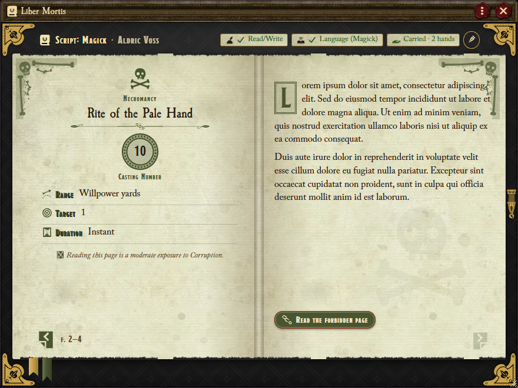 |

## ✨ Zaklęcia z księgi na karcie

Moduł trzyma się zasad WFRP 4e w takiej postaci, w jakiej obsługuje je system: zaklęcie na karcie, które **nie jest zapamiętane** (puste **M**), rzuca się z księgi, a pech losuje się z systemowej tabeli *Grimoire Miscast*.

Gdy księga jest przy postaci, każde zaklęcie, które postać może z niej rzucić, pojawia się w zakładce **Magia** jako niezapamiętane, z ikoną księgi. Można je rzucać z karty, z Action HUD albo z okna księgi, a karty czatu działają jak zwykle. Kopie znikają, gdy księga opuści postać, przestanie być noszona albo straci zaklęcie. Wracają, gdy postać zapomni zapamiętane zaklęcie, które wciąż jest w księdze.

| | |
|---|---|
| 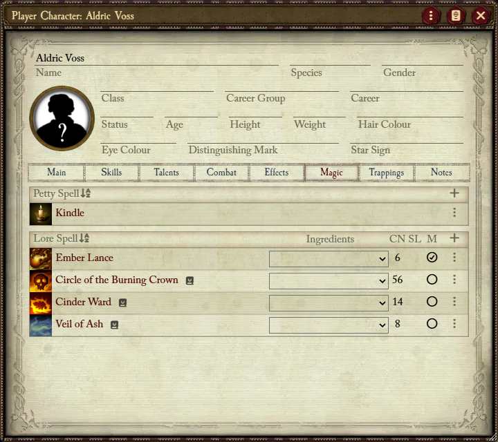 | 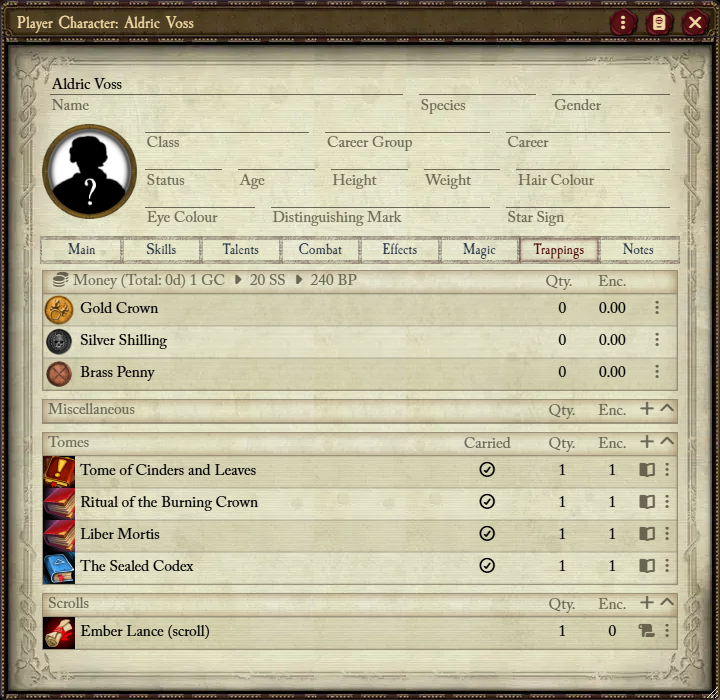 |

## 🎓 Zapamiętywanie

**Zapamiętaj** wysyła prośbę do MG. Po zgodzie MG systemowe okno *Memorize Spell* wylicza koszt PD według zasad (Ok / za darmo). Zaklęcie staje się własnym zaklęciem postaci: **M** jest zaznaczone, nie zależy już od księgi, a PD trafiają do dziennika doświadczenia. To samo dzieje się po zaznaczeniu **M** przy kopii z księgi bezpośrednio na karcie.

## 🔏 Czego może wymagać księga

Nowa księga mieści **4 zapisy**, bo zwykła księga magii zawiera około czterech zaklęć. **Rytuał zajmuje całą księgę**: można go wpisać tylko do pustej, a po nim nic więcej się nie zmieści. MG zmienia liczbę zapisów przy każdej księdze w trybie edycji albo zostawia pole puste (bez limitu). Księgi sprzed tej zasady, zwoje i księgi receptur alchemicznych nie mają limitu zapisów.

Wszystko poniżej jest domyślnie wyłączone. MG ustawia to przy każdej księdze w trybie edycji.

* **Strony**: limit tego, co się zmieści. Zaklęcie zajmuje 1 stronę, plus 1 na każde 5 PM.
* **Szyfr**: każdą stronę trzeba odczytać testem wybranej umiejętności (domyślnie języka księgi). Każdy sukces dodaje swoje PS, a strona wymaga ustawionej liczby PS na stronę. Pech albo porażka o 3 PS lub więcej kasuje pracę nad tą stroną. Postęp należy do postaci.
* **Zakazana**: pierwsze przeczytanie strony to ekspozycja na Zepsucie wybranej siły, ze zwykłym testem systemu. Gracz nie wie o tym z góry: widzi zwykłą nieprzeczytaną stronę z przyciskiem **Przeczytaj stronę** i o Zepsuciu dowiaduje się dopiero z testu. MG widzi ostrzeżenie wszędzie.
* **Ręce**: księgę noszoną przy sobie trzyma się domyślnie w obu rękach (MG może ustawić jedną rękę albo żadną). Wlicza się do punktów wyposażenia postaci jak broń, więc przy systemowym ustawieniu ograniczającym broń postać nie utrzyma księgi i broni ponad wolne ręce, a nagłówek pokazuje, ile rąk zajmuje księga.

**Przepisz do innej księgi** zapisuje wpis w innej księdze postaci po teście Wymagającym. Porażka daje wadliwy odpis (zaklęcie ma PM +2), a porażka o 2 PS lub więcej niszczy odpis.

## 📜 Zwoje

* Zwój to księga na jeden wpis, która się zużywa: przedmiot z *Książek i dokumentów* z językiem, a ilość oznacza liczbę zwojów. Zwoje mają własny dział **Zwoje**; każdy dokument można zamienić w zwój przyciskiem **Uczyń zwojem**.
* Okno zwoju pokazuje wpis, plakietki warunków i liczbę pozostałych zwojów.
* **Odczytaj i rzuć** uruchamia zwykły test rzucania systemu z bazowym PM zaklęcia, nawet gdy postać go nie zna, więc karty czatu (obrażenia, przeciążenie) działają jak zwykle. Potem zużywa się jeden zwój (opcjonalnie tylko po udanym teście). Ostatni rozsypuje się w pył.
* Rzucić ze zwoju może każdy, kto umie go odczytać (Czytanie/Pisanie i jego język, jeśli wymagane); znajomość Tradycji nie jest potrzebna.

## ⚙️ Ustawienia (świat)

* Nieudany test zużywa zwój
* Nazywaj zwoje od zawartości

Każdy gracz wybiera też **Wygląd ksiąg** (ustawienie klienta): *Iluminowany* (domyślny) pokazuje oprawną w skórę księgę zaklęć z mosiężnymi okuciami, w stylu szkoły magii, a *Klasyczny* zostawia prosty wygląd.

To, czego księga wymaga od czytelnika, ustawia się przy każdej księdze w trybie edycji.

Talenty i umiejętności są rozpoznawane **po angielsku i po polsku** (np. *Arcane Magic (Life)* / *Magia Tajemna (Życia)*, *Language (Magick)* / *Język (Magiczny)*), niezależnie od języka interfejsu Foundry. Postać zna też Tradycję, jeśli zna już jakieś jej zaklęcie.

## 🏰 Warhammer: The Old World

Moduł działa też w **Warhammer: The Old World** (system `whtow`). Okno księgi, spis treści, iluminowane strony, szyfry, przepisywanie między księgami i zwoje są takie same, ale zasady idą za tym systemem:

* Zgodnie z zasadami The Old World (*Formalise Spell*, *Memorise Spell*) czarodziej rzuca zaklęcia ze swojego grimuaru, a zapamiętane już go nie potrzebuje. Założona księga (**Przy sobie**) wpisuje więc na kartę kopie zaklęć ze szkół, które postać zna (z ikoną księgi). Rzuca się je jak każde zaklęcie z karty: test szkoły zbiera moc, a gdy dorówna Wartości Rzucania, wybierasz zaklęcie na czacie. Wartość nie jest podwajana. Odłożenie księgi zdejmuje kopie z karty. **Zapamiętaj** (za zgodą MG) zamienia kopię we własne zaklęcie postaci. W tym systemie zaklęcia nie kosztują PD.
* Medalion pokazuje **Wartość Rzucania (WR)**. Zasięg, cel i czas trwania pokazują wartość systemu i jego własny opis. Szkoły dostają wygląd szkół modułu: magia bitewna jak Ogień, żywiołów jak Niebiosa, iluzji jak Cienie, nekromancja i demonologia własne, pozostałe jak magia bez szkoły.
* Księgi i zwoje mają własne działy pod wyposażeniem (Trappings). Księga to przedmiot, który można założyć; założona znaczy **przy sobie**.
* System nie ma talentu Czytanie/Pisanie, umiejętności Język, punktów wyposażenia ani testu Zepsucia przy lekturze, więc te warunki i ustawienia są wyłączone. Księgę nadal trzeba mieć przy sobie, a warunek **Tradycji** spełnia postać, która zna już zaklęcie tej szkoły (dla pierwszego zaklęcia ucznia MG może go wyłączyć).
* Szyfr odczytuje się testem umiejętności wpisanej w księdze (domyślnie Przypominanie) i liczy sukcesy. Nieudany odpis jest wadliwy (WR +2), nigdy zniszczony.
* Zwój przechowuje treść zaklęcia, ale system nie ma rzucania ze zwojów.

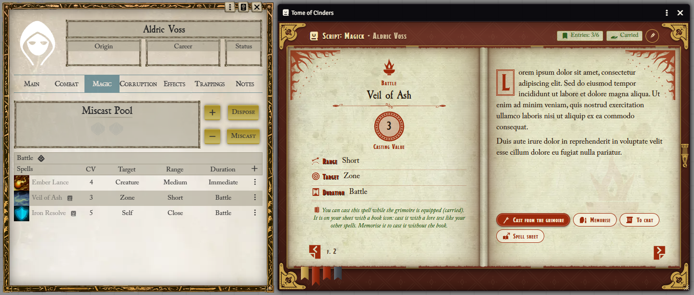

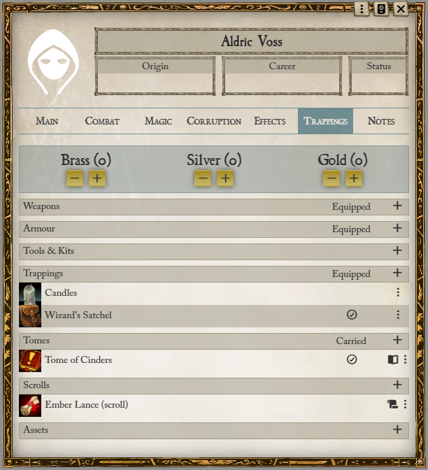

## 📦 Wymagania

* Foundry VTT **v14**
* system WFRP4e **10.0+** albo Warhammer: The Old World **1.3+**

## 🔌 API

```javascript
const api = game.modules.get("wfrp4e-grimoires").api;
api.create(actor);   // nowa księga u postaci
api.make(item);      // zamiana książki w księgę
api.open(item);      // otwarcie okna księgi
api.read(item);      // { form, language, cover, requirements, entries: [{ id, type, sourceUuid, data }] }
api.registerEntryType(type); // nowy rodzaj wpisów
```

Moduły mogą też rejestrować **rodzaj księgi** (`registerBookKind` w `scripts/public.mjs`, opis w `scripts/book-kinds.mjs`): to samo okno księgi z własnym działem w ekwipunku, pozycją w oknie tworzenia przedmiotu, ustawieniami domyślnymi, listą przyjmowanych wpisów i wyglądem. Rodzaj może działać z samego ekwipunku, bez trzymania w rękach. Korzysta z tego Alchemia Starego Świata (księgi alchemiczne).

Typ wpisu decyduje o wyglądzie i działaniu wpisu; okno, spis treści, warunki czytania i edycja są wspólne. Kontrakt opisuje `scripts/entry-types.mjs`. Moduły tej serii importują bezpośrednio `scripts/public.mjs`. Wpisy wyłączonego modułu zostają w księdze i wracają do działania po jego ponownym włączeniu.

## 🌐 Języki

Angielski i polski są wbudowane. Aby dodać kolejny język:

```bash
npm run lang:add -- de "Deutsch"
```

Polecenie tworzy `lang/de.json` (kopię tekstów angielskich) i dopisuje go do `module.json`. Przetłumacz teksty; każdy pominięty klucz pokaże się po angielsku, a `npm run check` wypisze nieprzetłumaczone klucze. Tłumaczenia mile widziane jako pull requesty.

Dla nowego języka uzupełnij też sekcję `Aliases`: nazwy talentów Czytanie/Pisanie, Magia Prosta i Magia Tajemna, umiejętności Język, Tradycji i języków ksiąg tak, jak brzmią w kompendiach w tym języku (rozdzielone przecinkami). Moduł rozpozna wtedy talenty i umiejętności postaci w tym języku.

Osobny moduł tłumaczenia może też dodać język bez zmian w tym module: deklaruje wpis `languages` z `"lang": "de"`, wskazujący na własny plik z tymi samymi kluczami.

## 🙏 Podziękowania

Inspiracja: księgi z *Forien's Armoury* autorstwa Foriena. Napisany od zera dla Foundry v14 i WFRP4e 10.x.

## 📄 Licencja

MIT – zobacz [LICENSE](LICENSE). Czcionki polskiej wersji, Grenze Gotisch (Omnibus-Type) i Almendra (Ana Sanfelippo), są na licencji SIL Open Font License; ich licencje leżą w `assets/fonts`.

Nieoficjalna twórczość fanowska, niezwiązana z Games Workshop ani Cubicle 7 i przez nie niepopierana. Warhammer i powiązane nazwy są znakami towarowymi Games Workshop Limited. Moduł nie zawiera tekstów ani grafik z podręczników – działa z treściami, które już posiadasz.
